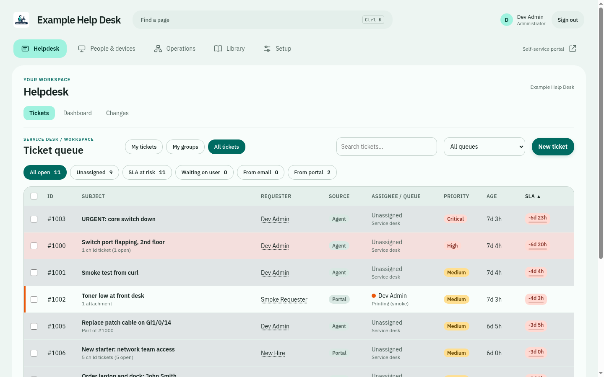
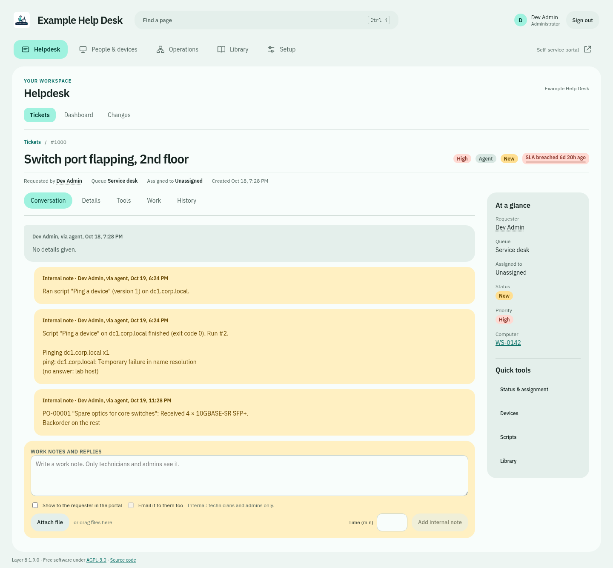
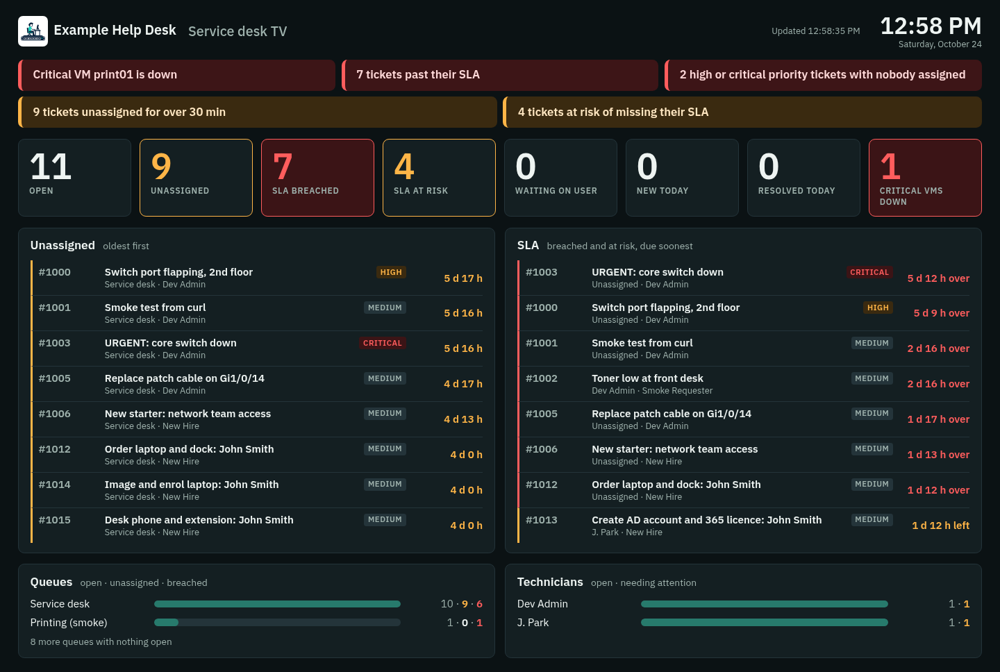
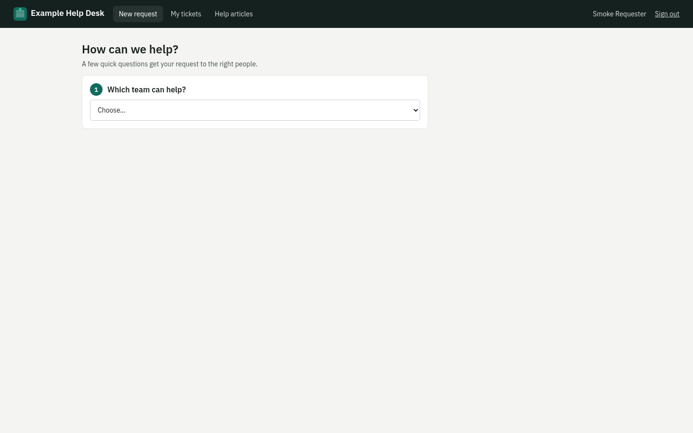
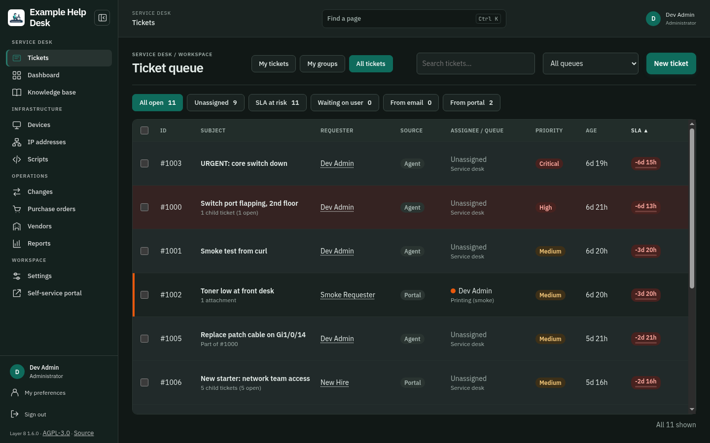

# Layer 8

The technician console uses **Ticket Focus**, a Material-inspired workspace with
Conversation, Details, Tools, Work and History. **Tidepool** is the default theme;
each technician can choose from five light/dark theme pairs, or follow the
organization default. Optional modules stay governed by administrator switches
and personal navigation preferences. [Workspace guide](docs/ticket-workspace.md).

*The service desk for the layer every network has: its people.*

Layer 8 is a self-hosted IT service desk that brings tickets, people, devices and technician tools into one workspace. Connect Microsoft Entra ID, Teams and Microsoft 365 Copilot to work from the ticket: see who is available, message the requester, investigate the problem and keep a record of the response. It runs on a single Linux appliance you control, with an offline installer and local accounts for standalone operation. Microsoft 365 and other integrations are optional.

> **Version 1.10.** Free software under the [GNU AGPL-3.0](LICENSE) (or later). In use on real desks; back up before upgrading.

## Microsoft 365, right where the work happens

Keep the conversation and the troubleshooting together. Technicians connect their own Microsoft work accounts; the service desk's mailbox and portal-presence jobs use separate application access.

| Feature | What it brings to the service desk |
| --- | --- |
| **Microsoft Entra ID sign-in** | Sign in with Microsoft using an existing Layer 8 account, with Entra MFA and Conditional Access. Existing roles open the helpdesk for technicians and self-service for requesters; local break-glass access remains available. [Sign-in guide](docs/entra-sign-in.md). |
| **Who's in? Desk hours and Teams presence** | The portal shows each queue's desk hours and technicians' availability: available, busy, away, offline or unknown. Requesters can see when support is open and when someone is next expected. Presence is status only, not attendance tracking or a portal chat button. [Desk hours and presence](docs/desk-hours.md). |
| **Teams chat from a ticket** | Message the requester as the connected technician in an existing one-to-one Teams chat. The sent message is recorded as a public ticket reply, keeping the support record with the ticket. [Teams setup](docs/teams.md#send-ticket-messages-as-a-technician). |
| **Microsoft 365 Copilot on tickets — preview** | Ask questions and follow up as the connected technician, review sources, then edit and save an answer as an internal note or send it as a reviewed requester reply. Review ticket context before sharing; internal notes require a separate choice. Requires the technician's Microsoft 365 Copilot licence and tenant setup; the Microsoft Chat API is a preview. [Copilot setup](docs/microsoft-365.md#5-copilot-on-tickets-preview). |
| **Email becomes work** | Exchange Online email creates tickets; replies, acknowledgements and notifications go through the service desk mailbox. Technicians can also assign, prioritise or close tickets by email commands. [Email setup](docs/email-setup.md). |
| **Keep the team informed** | Optional Teams Workflows cards share queue counts, while unaccepted-ticket alerts help surface work that needs an owner. Queue summaries exclude restricted queues. [Teams notifications](docs/teams.md). |

Each connection is optional and configured separately. Start with the [Microsoft 365 setup guide](docs/microsoft-365.md); enabling an integration never grants extra Layer 8 permissions.

**At a glance**

- **One queue** for tickets from email and the self-service portal, with queues, SLAs in desk hours, routing rules, checklists, canned replies, time tracking, alerts for tickets nobody takes, full-text search across all history, and an arrangeable ticket page.
- **The work around tickets:** devices from AD, IP address management with network scans, purchase orders, vendors, changes, a knowledge base, reports and a script library with relays.
- **Your network and tools:** Cisco Meraki, Ubiquiti UniFi and Juniper EX discovery and outage tickets, Nutanix VMs with power actions from tickets, Action1 patch status and reviewed software deployment, Dell and Lenovo warranties, all opt-in and read-only unless you say otherwise.
- **For the room:** a remote display for a big screen, desk hours on the portal, a Ctrl+K palette, dark mode and three dark themes (Midnight, Ember, Ultraviolet), and a sidebar each technician can trim.
- **Sign-in your way:** one entry screen routes requesters to self-service and technicians/admins to the helpdesk using their existing roles. Local accounts with two-factor, AD, Windows sign-in to the portal, and Sign in with Microsoft remain available. Windows portal-only sessions still require a separate console sign-in.
- **Make the welcome page yours:** uploaded backgrounds and logos, image fit/focus/darkening, card placement and width, optional gradient/grid backdrops and a welcome heading, with a live preview and a Restore default light theme option in Settings > Branding ([customization guide](docs/login-branding.md)).
- **Runs on one box you control:** an offline appliance ISO (Debian 13) with a setup wizard and a recovery console, encrypted backups, signed updates from GitHub releases, and no cloud required.

  
  
  
  

All screenshots, from the demo data: [screenshots/](screenshots/README.md).

## What it does

**Tickets**
- Reviewed [ticket templates](docs/ticket-templates.md) fill empty fields in New ticket while preserving requester details, drafts and explicit queue/priority choices. Shared templates are managed under Settings > Helpdesk.
- Email (Microsoft 365 / Exchange Online through Graph) and a self-service portal feed one queue and one routing engine. Requesters hear back in your words: the acknowledgement, and optional resolved and assigned emails, are editable with a preview.
- Queues with owners, managers and restricted visibility; priorities from urgency × impact; SLAs that count desk hours, stop while waiting on the user, and show the time left ([docs/desk-hours.md](docs/desk-hours.md#the-sla-clock)).
- Alerts when nobody takes a ticket: an email to everyone who could, or a post in a Teams channel, and a counter in the console ([docs/desk-hours.md](docs/desk-hours.md#tickets-nobody-has-taken)).
- Search every ticket's subject, description and notes, closed history and imported Track-It! numbers included ([docs/ticket-search.md](docs/ticket-search.md)).
- Click a requester for their contact card (title, department, phone, mobile, office, manager from AD); their page lists their devices, AD groups and every ticket they've logged ([docs/people.md](docs/people.md)).
- A queue that keeps loading as you scroll, with compact or comfortable rows, chosen per technician in My preferences ([docs/workspace-preferences.md](docs/workspace-preferences.md#ticket-list)).
- Custom ticket rules: run on save, on a schedule, or through guarded SQL.
- Merge, parent and child tickets, bulk changes, and a personal widget workspace: searchable library, essentials-only starting point, saved placement and administrator defaults ([guide](docs/widget-workspace.md)).
- **Library:** local knowledge articles alongside optional SharePoint runbook/FAQ page search, using the technician’s Microsoft account and an approved IT site. Review a source link before adding it as an internal ticket reference ([setup and access](docs/library.md)).
- Canned replies, shared or personal and per queue, with the ticket's details filled in ([docs/canned-replies.md](docs/canned-replies.md)).
- Time tracking: log minutes with a note or in a ticket's Time panel; the *Time spent* report adds them up by technician, queue, category or day.
- A grouped, collapsible technician sidebar and contextual header shared across the console; module pages use consistent headings, toolbars and tables. Settings has searchable setup groups and automatically compacts the main sidebar, restoring it when you leave. Existing branding, module visibility and ticket layouts are preserved ([layout review](docs/application-layout.md)).
- Related open-ticket suggestions on the Work tab explain shared devices, systems, VMs or meaningful subject matches. Only tickets the technician may see are considered; parent/child linking requires review ([ticket workspace](docs/ticket-workspace.md#related-open-tickets)).
- One update to everyone affected: from a ticket with linked child tickets, preview and send one message to all their requesters (one email each, a public reply on every ticket), and optionally resolve them all ([ticket workspace](docs/ticket-workspace.md#update-everyone-affected)).
- A ticket page that puts the conversation first, with Work and History tabs and a drawer of tools (details, devices, directory, scripts, network…); the classic arranged layout is still there ([docs/ticket-workspace.md](docs/ticket-workspace.md)).
- Act on tickets by replying to email (`#close`, `#assign`, `#priority`).
- Checklists for onboarding and offboarding, where each step becomes a child ticket due on its day.
- A remote display for a big screen in the IT office: live counts, alerts (SLA breaches, unassigned tickets) and the tickets that need someone, opened by a secret link.
- Desk hours per queue on the portal, with an after-hours message saying when someone is next in, and technicians' Teams status (status only).

**People and access**

- Local accounts that need nothing else, or AD/LDAP sign-in with roles from AD groups.
- Silent Windows sign-in (Kerberos) to the portal.
- Two-factor sign-in with an authenticator app (required for local admins if you choose), and Sign in with Microsoft (Entra ID) for existing accounts ([docs/entra-sign-in.md](docs/entra-sign-in.md)).
- Creating AD accounts from a ticket: onboarding templates, group lists, a start date, and the password shown once.
- Finer permissions: who may delete, merge, publish or manage each area, by group.
- Admins choose which areas the organization uses (Settings > Modules), and each technician can trim their own sidebar further ([docs/workspace-preferences.md](docs/workspace-preferences.md)).

**Devices and network**

- Devices from AD computer objects, with tickets, IP addresses, switch port and lifecycle on each.
- Patch status read from Action1, and opt-in software deployment through Action1: one reviewed package to one ticket-linked computer, logged on the ticket ([docs/action1.md](docs/action1.md)).
- Cisco Meraki, read-only and opt-in: client discovery (switch port, VLAN, SSID) on IP records, devices and tickets; port and wireless diagnostics; and device outage tickets from Meraki alerts.
- Ubiquiti UniFi, opt-in, through the cloud or a local console: equipment with its state, client discovery on IP records, devices and tickets, outage tickets for offline equipment, and guest Wi-Fi vouchers from a ticket ([docs/unifi.md](docs/unifi.md)).
- Juniper EX switches (configured one by one), opt-in and read-only: a relay on the LAN reads each switch's Junos REST API, so clients show with their switch, port and VLAN; outage tickets for switches that stop answering ([docs/juniper.md](docs/juniper.md)).
- Nutanix AHV through Prism Central, opt-in: VMs with their power state, host and addresses, matched to devices and linked to tickets; optional restart, power on and power cycle from a ticket, each noted on it; outage tickets and a remote display tile for critical VMs ([docs/nutanix.md](docs/nutanix.md)).
- Dell and Lenovo warranty lookups through their official APIs.
- IP address management:
  - subnets and VLANs, with a used/free map
  - scans by a relay on the LAN (ping, reverse DNS, ARP)
  - Windows DHCP leases and DNS records
  - SNMP discovery with LLDP neighbours and switch MAC tables

  Scans flag differences; they never change your records by themselves.
- Stale and unknown device sweeps, and warranty and replacement forecasting.

**Automation**

- A script library: PowerShell (locally or over WinRM), bash, Python and Arista EOS.
- 27 ready-made SQL queries to add from the Scripts page: ticket throughput and ageing, reopened and moved tickets, first-response and resolution times, busiest requesters and hours, warranties, replacements, duplicate serials and more. Device and people queries double as dynamic groups.
- Scripts run on "relays" that pull work over HTTPS, so no inbound ports are needed.
- Versions with diffs, approval for high-risk scripts, schedules, and every run logged on its ticket.
- A Remote Assistance button on tickets, logged as well.

**Everything else a desk needs**

- Knowledge base with versions and images, suggested in the portal as people type.
- Satisfaction surveys on a random share of solved tickets.
- Change management: approvals, a calendar, overlap warnings, and Action1 patch nights as standard changes.
- Purchase orders, with receiving by the clerk, vendors and systems.
- Reports with charts, PDF/CSV export and scheduled email delivery; a system log and status page.
- Integration health in Settings > Status: configuration gaps, failed/overdue worker passes, last successes and relay check-ins, with recovery links ([guide](docs/integration-health.md)).
- Encrypted backups to SMB/NFS with restore; a recovery console on the appliance; import from Track-It! and Spiceworks Cloud Help Desk ([docs/spiceworks-import.md](docs/spiceworks-import.md)).
- Admin **Settings > System > Imports** adds KACE ticket-bundle preview and confirmed import, with a separate read-only API exporter. Live KACE appliance validation is pending ([docs/kace-import.md](docs/kace-import.md)).
- Signed updates: Settings > Updates checks Layer 8's stable GitHub releases, verifies the publisher's signature, backs up first and checks the result. Open pages reconnect after restarts; a changed frontend refreshes automatically when no edited controls remain. A maintenance page also reconnects fresh browser visits ([docs/github-updates.md](docs/github-updates.md)).

Screenshots of every page, in light and dark and in each theme: [screenshots/](screenshots/README.md) (an earlier gallery: [command-center](screenshots/command-center/README.md)). The full requirements and decisions are in [SPEC.md](SPEC.md).

## Try it

- **Appliance ISO (recommended):** download `layer8-v<version>.iso` from the [latest release](https://github.com/ddziubanski/layer8/releases/latest) and check it against `SHA256SUMS`. It's Debian 13 plus Layer 8, installs with no internet access, and asks its questions in a setup wizard on first boot (or choose the offline demo there). The boot menu defaults to choosing the disk and partitioning; erasing the first disk is a separate choice. To build it yourself: `iso/build.sh` (needs Docker and npm). See [docs/install.md](docs/install.md).
- **On an existing Debian 13 server:** `install/install.sh`, same doc.
- **For development:** [backend/README.md](backend/README.md) covers the dev database (Docker Compose), the API, the web UI, tests and migrations.

Every setting can be changed in the app (Settings), and also imported from an answers file, so installs can be scripted end to end.

## Planned and under review

- **Updates without internet access:** importing a signed update package from a USB stick or file share (online updates from GitHub releases are in 1.2).
- **Action1 deployment, later slices ([#33](https://github.com/ddziubanski/layer8/issues/33)):** bulk/group targets, scheduled deployments and onboarding software bundles. One reviewed package to one ticket-linked computer is already available (opt-in, Settings > Action1).

## Integrations (all optional)

| | Guide |
|---|---|
| Email intake and notifications (Microsoft Entra app, Graph) | [docs/email-setup.md](docs/email-setup.md) |
| Technician Teams messages and queue summaries | [docs/teams.md](docs/teams.md) |
| Windows sign-in (Kerberos SSO) | [docs/windows-sign-in.md](docs/windows-sign-in.md) |
| Two-factor sign-in and Sign in with Microsoft (Entra ID) | [docs/entra-sign-in.md](docs/entra-sign-in.md) |
| Relays: scripts, AD changes, IP scans, DHCP/DNS, SNMP | [docs/runner.md](docs/runner.md) |
| Remote Assistance from tickets | [docs/remote-assistance.md](docs/remote-assistance.md) |
| Action1 patch status and patch automation calendar (read-only) | [docs/action1.md](docs/action1.md) |
| Cisco Meraki (discovery, diagnostics, alert webhooks) | [docs/meraki-webhooks.md](docs/meraki-webhooks.md) |
| Dell and Lenovo warranty lookups | [docs/warranty.md](docs/warranty.md) |
| Moving from Track-It! | [docs/trackit-import.md](docs/trackit-import.md) |
| Importing Spiceworks Cloud Help Desk exports | [docs/spiceworks-import.md](docs/spiceworks-import.md) |
| KACE ticket imports (live appliance validation pending) | [docs/kace-import.md](docs/kace-import.md) |
| Recovery console | [docs/recovery-console.md](docs/recovery-console.md) |
| Appliance updates (signed GitHub releases) | [docs/github-updates.md](docs/github-updates.md) |
| Other apps (API keys: look up tickets, add notes) | [docs/integrations.md](docs/integrations.md) |
| Remote displays (live board for a big screen, secret link) | [docs/wallboard.md](docs/wallboard.md) |
| Ubiquiti UniFi (cloud or local console) | [docs/unifi.md](docs/unifi.md) |
| Juniper EX switches (Junos REST, through a relay) | [docs/juniper.md](docs/juniper.md) |
| Nutanix AHV (Prism Central v4 API) | [docs/nutanix.md](docs/nutanix.md) |
| Desk hours and technicians' Teams status on the portal | [docs/desk-hours.md](docs/desk-hours.md) |
| **Microsoft 365, step by step** (email, Teams, technician connections, Copilot) | [docs/microsoft-365.md](docs/microsoft-365.md) |

## Built with

Python and FastAPI, PostgreSQL, React and TypeScript. The relay is a single Python file using only the standard library. The appliance is Debian 13 with nginx.

## Contributing and security

Issues and pull requests are welcome: see [CONTRIBUTING.md](CONTRIBUTING.md). Please report security problems privately, as described in [SECURITY.md](SECURITY.md).

## License

Layer 8 is free software: you can redistribute it and/or modify it under the terms of the
[GNU Affero General Public License](LICENSE) as published by the Free Software Foundation,
either version 3 of the License, or (at your option) any later version (SPDX:
`AGPL-3.0-or-later`). It is distributed in the hope that it will be useful, but WITHOUT ANY
WARRANTY; see the license for details.

Copyright (C) 2026 Dan Dziubanski and contributors.

**What this means in practice.** You can run it, change it and share it. If you run a
modified copy for other people over a network, offer them its source too. Layer 8 does this for
you: the console, the portal and the sign-in page link to **Source code**, which downloads the
exact source of the running installation (packed by the ISO build), and to the repository
(Settings > General > Source code address; point it at your own fork if you change Layer 8).

**Earlier versions.** Releases before 1.0 (the 0.1 alphas) were published under the MIT
license, and copies of those releases remain available under MIT. Version 1.0 and everything
after it is AGPL-3.0-or-later.

## Credits

Built by Dan Dziubanski, with Claude (Anthropic): aka Claude The Homie.

The UniFi integration's map of Ubiquiti's APIs comes from ["UniFi best practices"](https://github.com/uchkunr/unifi-best-practices) by uchkunr, licensed [CC BY 4.0](https://creativecommons.org/licenses/by/4.0/); Ubiquiti's documentation is at [developer.ui.com](https://developer.ui.com).
