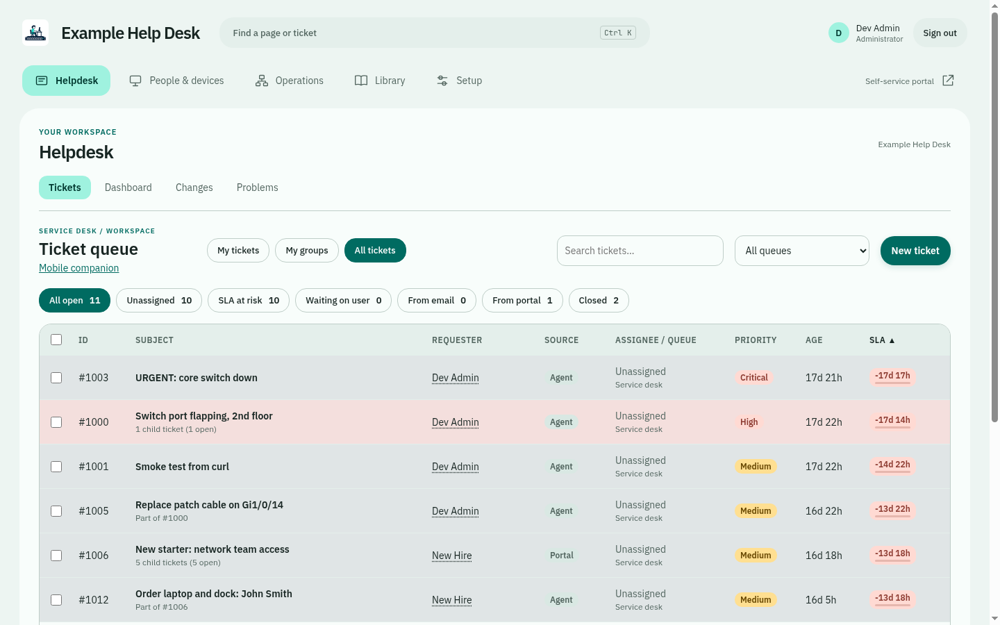
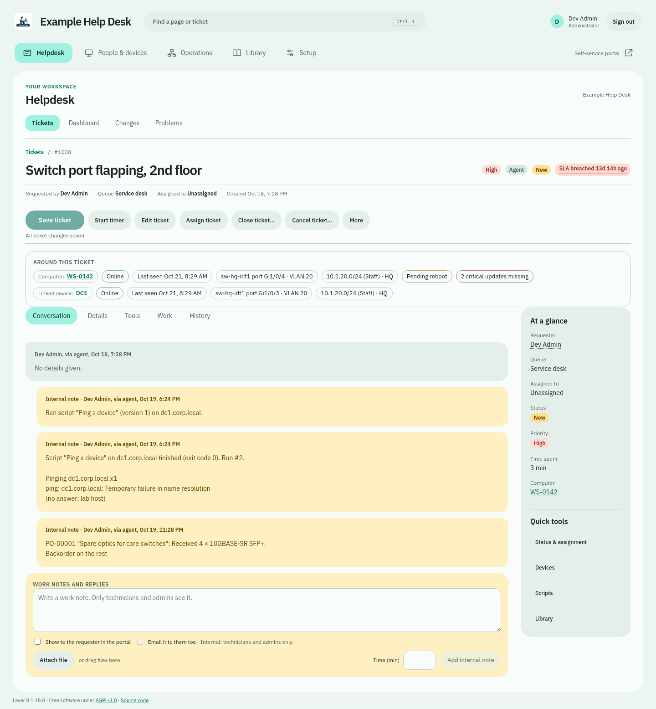
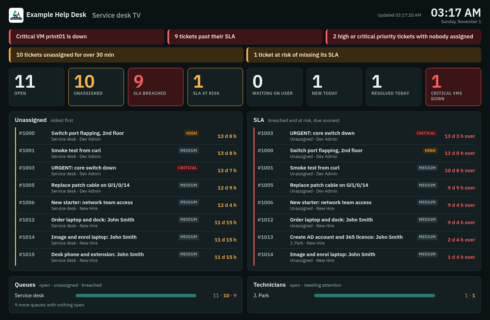
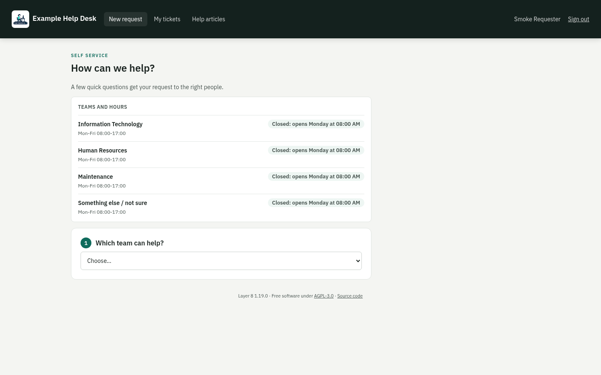
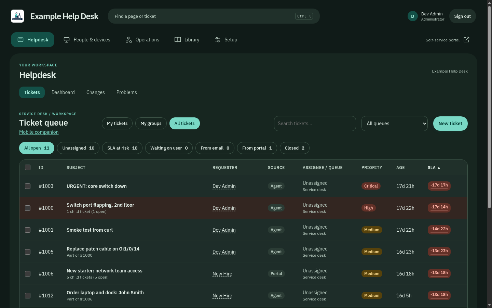

# Layer 8

*The service desk for the layer every network has: its people.*

Layer 8 is a self-hosted IT service desk where tickets, people, devices and the network are connected instead of filed in separate places. A device that drops off the network opens a ticket, and its recovery shows up on it. A ticket shows the workaround from the problem it belongs to. A device's page tells its whole story. It runs on one Linux appliance you control, installs offline, and works with local accounts alone; every integration is optional.

> **Version 1.15.** Free software under the [GNU AGPL-3.0](LICENSE) (or later). In use on real desks; back up before upgrading.

## Highlights

- **Connected tickets.** Related-ticket suggestions, parent and child tickets, problems with their workaround on every linked ticket, and one reviewed update to everyone affected by an outage.
- **Find anything fast.** Ctrl K jumps to any page or ticket; the highlighted ticket opens a preview (status, SLA, requester, latest note, workaround) without leaving the page. Full-text search covers every ticket, closed history included.
- **Time that counts itself.** Start a timer on a ticket; an *Active ticket timers* bar follows you across the console, and closing the ticket logs what's still running.
- **Devices with a history.** One timeline per device from tickets, changes, scripts, remote sessions, software deployments and IP records, with what's true right now (online, pending reboot, missing updates) and what's coming (warranty end).
- **A network that raises its hand.** Meraki, UniFi, Juniper and Nutanix outages open tickets; when the equipment comes back the ticket says *Verify*.
- **Yours to run.** An offline appliance ISO with a setup wizard, encrypted backups, signed updates and a recovery console. No cloud required.

  
  
  
  

All screenshots, from the demo data: [screenshots/](screenshots/README.md).

## Feature sets

### Tickets

- **One queue, two doors:** email and the self-service portal feed the same queue and routing engine. Requesters hear back in your words (editable acknowledgement, resolved and assigned emails with a preview).
- **Queues, SLAs and routing:** queues with owners, managers and restricted visibility; priority from urgency × impact; SLAs that count desk hours, pause while waiting on the user and show time left ([desk hours](docs/desk-hours.md#the-sla-clock)); routing and custom ticket rules (on save, on a schedule, or guarded SQL).
- **The ticket workspace:** Conversation, Details, Work, Tools and History tabs, a sticky action bar (Save, Edit, Assign, Close, Cancel), Save ticket next to every edit, and each pane in its own shade ([guide](docs/ticket-workspace.md)).
- **Working the ticket:** canned replies with the ticket's details filled in, [ticket templates](docs/ticket-templates.md), checklists that turn into child tickets, merge, bulk changes, email commands (`#close`, `#assign`, `#priority`), and Remote Assistance logged on the ticket.
- **Time tracking:** [ticket timers](docs/ticket-timers.md) with an *Active ticket timers* bar, manual entries with notes, a total on every ticket, and a *Time spent* report by technician, queue, category or day.
- **Nobody left waiting:** alerts when nobody takes a ticket (email or a Teams channel) and a counter in the console ([guide](docs/desk-hours.md#tickets-nobody-has-taken)).
- **Search:** subject, description and notes across all history, imported ticket numbers included ([guide](docs/ticket-search.md)), plus the Ctrl K quick lookup with preview.
- **Mobile companion:** a compact `/mobile` view for checking and answering tickets away from the desk ([guide](docs/mobile-companion.md)).

### Problems, changes and knowledge

- **Problem management:** problems group the tickets behind one root cause, with status (open → known error → resolved), owner, root cause, workaround and an internal timeline. Tickets show their problem's workaround; link or create one from the ticket ([guide](docs/problem-management.md)).
- **Update everyone affected:** from a parent ticket, preview and send one message to every requester of its child tickets, and optionally resolve them all.
- **Change management:** approvals, a calendar, overlap warnings, templates and standard changes, linked to tickets, devices and systems.
- **Knowledge:** a local knowledge base with versions and images, suggested in the portal as people type, and an optional SharePoint Library search for runbooks and FAQs ([guide](docs/library.md)).

### People and access

- **Sign-in your way:** local accounts with two-factor, AD/LDAP with roles from AD groups, silent Windows sign-in (Kerberos) to the portal, and Sign in with Microsoft. One entry screen sends requesters to self-service and technicians to the console.
- **People pages:** contact cards from AD (title, department, phone, manager), with each person's devices, groups and tickets ([guide](docs/people.md)).
- **AD from the ticket:** create accounts from onboarding templates, with group lists and a start date.
- **Fine-grained permissions** by group (delete, merge, publish, manage each area), admin-chosen modules, and a sidebar each technician can trim ([guide](docs/workspace-preferences.md)).
- **Your look:** seven theme palettes in light and dark, organisation and personal defaults, and a customisable sign-in page ([branding](docs/login-branding.md)).

### Devices and network

- **Devices from AD**, each with a [timeline](docs/device-timeline.md), tickets, IP addresses, switch port, lifecycle, warranty (Dell and Lenovo lookups) and replacement forecasting; stale and unknown device sweeps.
- **IP address management:** subnets and VLANs with a used/free map; scans by a relay on the LAN (ping, reverse DNS, ARP), Windows DHCP leases and DNS records, SNMP with LLDP neighbours and switch MAC tables. Scans flag differences; they never change your records by themselves.
- **Network discovery and outage tickets**, each opt-in: Cisco Meraki (clients, port and wireless diagnostics, alert webhooks), Ubiquiti UniFi (cloud or local console, guest Wi-Fi vouchers from a ticket), Juniper EX (Junos REST through a relay) and Nutanix AHV (VM state, and optional power actions from a ticket). Scanned equipment, clients and IP records can be linked to tickets.

### Automation

- **Script library:** PowerShell (locally or over WinRM), bash, Python and EOS-style CLI, with versions and diffs, approval for high-risk scripts, schedules, and every run logged on its ticket.
- **Relays** pull work over HTTPS, so no inbound ports are needed. A deployment kit installs them as a locked-down Linux service or through a Windows GPO ([guide](docs/relay-deployment.md)).
- **27 ready-made SQL queries** (throughput, ageing, response times, warranties, duplicate serials and more); device and people queries double as dynamic groups.
- **Action1:** patch status, the patch calendar as standard changes, reviewed single-device software deployment, and remote desktop from a ticket, each opt-in ([guide](docs/action1.md)).

### Reporting and visibility

- Reports with charts, PDF/CSV export and scheduled email delivery; satisfaction surveys on a share of solved tickets.
- A remote display for a big screen (live counts, SLA breaches, unassigned tickets), desk hours and technicians' availability on the portal, and service notices.
- Integration health, a system log and a status page ([guide](docs/integration-health.md)).

### Microsoft 365 (optional)

Email intake and notifications through Exchange Online, Sign in with Microsoft (Entra ID), technicians' Teams presence on the portal, Teams chat with the requester from a ticket, Teams queue summaries, SharePoint Library search, and Microsoft 365 Copilot on tickets (preview). Each piece is set up separately and grants no extra Layer 8 permissions. Start with the [Microsoft 365 guide](docs/microsoft-365.md).

### The appliance

- An offline appliance ISO (Debian 13) with a setup wizard, or an answers file for unattended installs; every setting is also editable in the app and importable.
- Signed updates from GitHub releases that back up first and verify the result ([guide](docs/github-updates.md)); encrypted backups to SMB/NFS with restore; a recovery console.
- Imports from Track-It!, Spiceworks Cloud Help Desk and KACE.

The full requirements and decisions are in [SPEC.md](SPEC.md).

## Try it

- **Appliance ISO (recommended):** download `layer8-v<version>.iso` from the [latest release](https://github.com/ddziubanski/layer8/releases/latest) and check it against `SHA256SUMS`. It installs with no internet access and asks its questions in a setup wizard on first boot (or choose the offline demo there). The boot menu waits for you to choose the disk; erasing the first disk is a separate choice. To build it yourself: `iso/build.sh` (needs Docker and npm). See [docs/install.md](docs/install.md).
- **On an existing Debian 13 server:** `install/install.sh`, same doc.
- **For development:** [backend/README.md](backend/README.md) covers the dev database (Docker Compose), the API, the web UI, tests and migrations.

## What's next

Layer 8 already holds a lot of connected data; the roadmap joins more of it up:
- **Device timeline, part 2 ([#156](https://github.com/ddziubanski/layer8/issues/156)):** online/offline, switch-port, IP, patch and AD changes recorded as they happen.
- **Context on every ticket ([#157](https://github.com/ddziubanski/layer8/issues/157)):** the requester's device state, open outages, problems and recent changes nearby.
- **Change → incident correlation ([#158](https://github.com/ddziubanski/layer8/issues/158))** and **outage → problem → everyone ([#159](https://github.com/ddziubanski/layer8/issues/159)).**
- **Self-checking tickets ([#160](https://github.com/ddziubanski/layer8/issues/160))** and **problem suggestions from patterns ([#161](https://github.com/ddziubanski/layer8/issues/161)).**
- **One search for everything ([#162](https://github.com/ddziubanski/layer8/issues/162)),** **live updates ([#163](https://github.com/ddziubanski/layer8/issues/163))** and **proactive tickets ([#164](https://github.com/ddziubanski/layer8/issues/164)).**
- **Action1 bulk and scheduled deployments ([#33](https://github.com/ddziubanski/layer8/issues/33))** and **updates without internet access** (a signed package from USB or a file share).

## Setup guides

| | Guide |
|---|---|
| Email intake and notifications (Microsoft Entra app, Graph) | [docs/email-setup.md](docs/email-setup.md) |
| Technician Teams messages and queue summaries | [docs/teams.md](docs/teams.md) |
| Windows sign-in (Kerberos SSO) | [docs/windows-sign-in.md](docs/windows-sign-in.md) |
| Two-factor sign-in and Sign in with Microsoft (Entra ID) | [docs/entra-sign-in.md](docs/entra-sign-in.md) |
| Relays: scripts, AD changes, IP scans, DHCP/DNS, SNMP | [docs/runner.md](docs/runner.md) |
| Remote Assistance from tickets | [docs/remote-assistance.md](docs/remote-assistance.md) |
| Action1 patch status and patch automation calendar (read-only) | [docs/action1.md](docs/action1.md) |
| Cisco Meraki (discovery, diagnostics, alert webhooks) | [docs/meraki-webhooks.md](docs/meraki-webhooks.md) |
| Dell and Lenovo warranty lookups | [docs/warranty.md](docs/warranty.md) |
| Moving from Track-It! | [docs/trackit-import.md](docs/trackit-import.md) |
| Importing Spiceworks Cloud Help Desk exports | [docs/spiceworks-import.md](docs/spiceworks-import.md) |
| KACE ticket imports (live appliance validation pending) | [docs/kace-import.md](docs/kace-import.md) |
| Recovery console | [docs/recovery-console.md](docs/recovery-console.md) |
| Appliance updates (signed GitHub releases) | [docs/github-updates.md](docs/github-updates.md) |
| Other apps (API keys: look up tickets, add notes) | [docs/integrations.md](docs/integrations.md) |
| Remote displays (live board for a big screen, secret link) | [docs/wallboard.md](docs/wallboard.md) |
| Ubiquiti UniFi (cloud or local console) | [docs/unifi.md](docs/unifi.md) |
| Juniper EX switches (Junos REST, through a relay) | [docs/juniper.md](docs/juniper.md) |
| Nutanix AHV (Prism Central v4 API) | [docs/nutanix.md](docs/nutanix.md) |
| Desk hours and technicians' Teams status on the portal | [docs/desk-hours.md](docs/desk-hours.md) |
| Microsoft 365, step by step (email, Teams, technician connections, Copilot) | [docs/microsoft-365.md](docs/microsoft-365.md) |
| Relay deployment kit (Linux service, Windows GPO) | [docs/relay-deployment.md](docs/relay-deployment.md) |
| Problem management | [docs/problem-management.md](docs/problem-management.md) |
| Ticket timers | [docs/ticket-timers.md](docs/ticket-timers.md) |
| Device timeline | [docs/device-timeline.md](docs/device-timeline.md) |

## Built with

Python and FastAPI, PostgreSQL, React and TypeScript. The relay is a single Python file using only the standard library. The appliance is Debian 13 with nginx.

## Contributing and security

Issues and pull requests are welcome: see [CONTRIBUTING.md](CONTRIBUTING.md). Please report security problems privately, as described in [SECURITY.md](SECURITY.md).

## License

Layer 8 is free software: you can redistribute it and/or modify it under the terms of the
[GNU Affero General Public License](LICENSE) as published by the Free Software Foundation,
either version 3 of the License, or (at your option) any later version (SPDX:
`AGPL-3.0-or-later`). It is distributed in the hope that it will be useful, but WITHOUT ANY
WARRANTY; see the license for details.

Copyright (C) 2026 Dan Dziubanski and contributors.

**What this means in practice.** You can run it, change it and share it. If you run a
modified copy for other people over a network, offer them its source too. Layer 8 does this for
you: the console, the portal and the sign-in page link to **Source code**, which downloads the
exact source of the running installation (packed by the ISO build), and to the repository
(Settings > General > Source code address; point it at your own fork if you change Layer 8).

**Earlier versions.** Releases before 1.0 (the 0.1 alphas) were published under the MIT
license, and copies of those releases remain available under MIT. Version 1.0 and everything
after it is AGPL-3.0-or-later.

## Credits

Built by Dan Dziubanski, with Claude (Anthropic): aka Claude The Homie.

The UniFi integration's map of Ubiquiti's APIs comes from ["UniFi best practices"](https://github.com/uchkunr/unifi-best-practices) by uchkunr, licensed [CC BY 4.0](https://creativecommons.org/licenses/by/4.0/); Ubiquiti's documentation is at [developer.ui.com](https://developer.ui.com).
