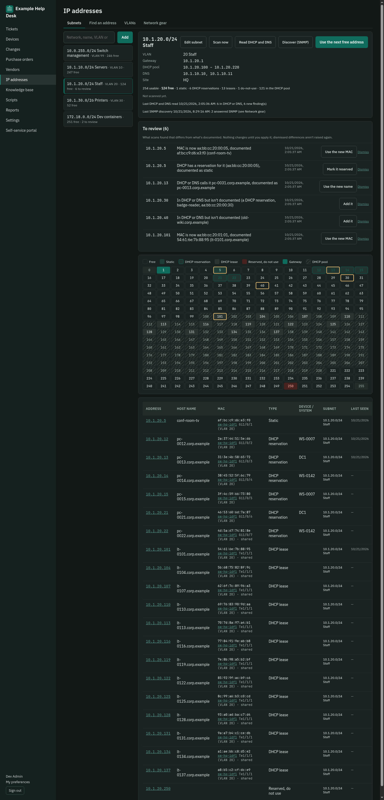
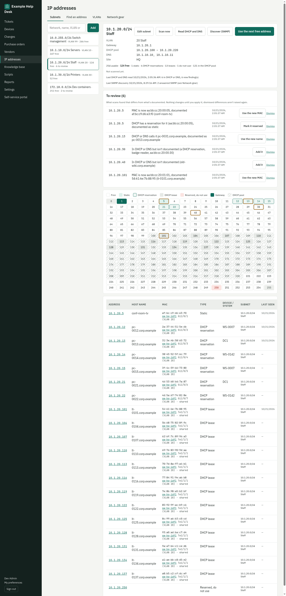
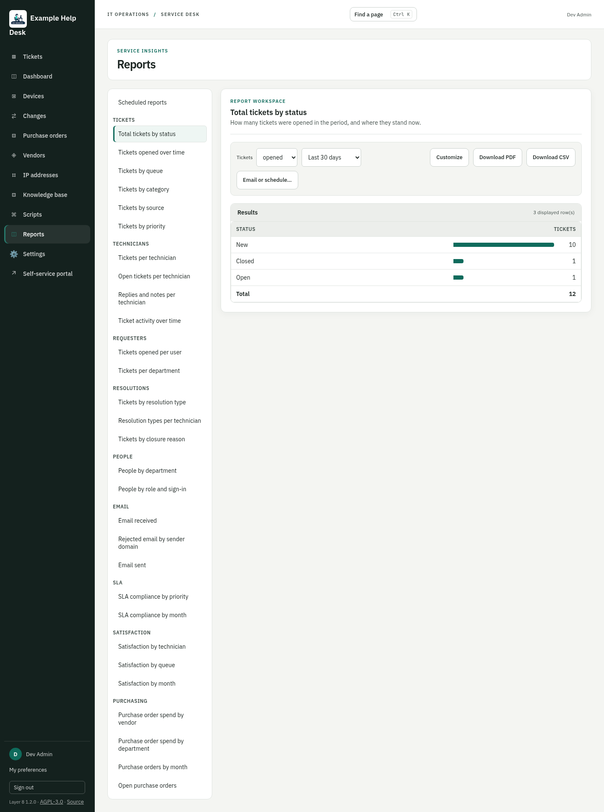

# Layer 8

*The service desk for the layer every network has: its people.*

Layer 8 is a self-hosted IT service desk for small and mid-sized IT teams: one queue for tickets from email and a self-service portal, with the tools a desk actually uses day to day, all in one install you control. It borrows the best ideas from ManageEngine, Track-It!, KACE and Spiceworks, runs on a single Linux box (an appliance ISO installs it offline), and works standalone or with Active Directory and Microsoft 365.

> **Status: alpha.** It's being tested on real desks now. Expect rough edges, and back up before upgrading.

## What it does

**Tickets**
- Email (Microsoft 365 / Exchange Online through Graph) and a self-service portal feed one queue and one routing engine.
- Queues with owners, managers and restricted visibility; SLAs; priorities from urgency × impact.
- KACE-style ticket rules: on save, on a schedule, or in SQL.
- Merge, parent and child tickets, bulk changes, and a page layout each technician can arrange.
- "Tickets Anywhere": technicians act on tickets by replying to email (`#close`, `#assign`, `#priority`).
- Checklists for onboarding and offboarding, where each step becomes a child ticket due on its day.

**People and access**
- Local accounts that need nothing else, or AD/LDAP sign-in with roles from AD groups.
- Silent Windows sign-in (Kerberos) to the portal.
- Creating AD accounts from a ticket: onboarding templates, group lists, a start date, and the password shown once.
- Finer permissions: who may delete, merge, publish or manage each area, by group.

**Devices and network**
- Devices from AD computer objects, with tickets, IP addresses, switch port and lifecycle on each.
- Patch status read from Action1, and Dell and Lenovo warranty lookups through their official APIs.
- IP address management:
  - subnets and VLANs, with a used/free map
  - scans by a runner on the LAN (ping, reverse DNS, ARP)
  - Windows DHCP leases and DNS records
  - SNMP discovery with LLDP neighbours and switch MAC tables

  Scans flag differences; they never change your records by themselves.
- Stale and unknown device sweeps, and warranty and replacement forecasting.

**Automation**
- A script library: PowerShell (locally or over WinRM), bash, Python and Arista EOS.
- Scripts run on "runners" that pull work over HTTPS, so no inbound ports are needed.
- Versions with diffs, approval for high-risk scripts, schedules, and every run logged on its ticket.
- A Remote Assistance button on tickets, logged as well.

**Everything else a desk needs**
- Knowledge base with versions and images, suggested in the portal as people type.
- Satisfaction surveys on a random share of solved tickets.
- Change management: approvals, a calendar, overlap warnings, and Action1 patch nights as standard changes.
- Purchase orders, with receiving by the clerk, vendors and systems.
- Reports with charts, PDF/CSV export and scheduled email delivery; a system log and status page.
- Encrypted backups to SMB/NFS with restore; a recovery console on the appliance; import from Track-It!.

**Dark mode** (Settings > Branding: off, always, or following each person's device):

  
  

More screenshots: [screenshots/](screenshots/README.md). The full requirements and decisions: [SPEC.md](SPEC.md).

  
  
  
  

## Try it

- **Appliance ISO (recommended):** Debian 13 plus Layer 8. It installs with no internet access and asks its questions in a setup wizard on first boot. Build it with `iso/build.sh` (needs Docker and npm), or `iso/build.sh --demo` for a one-click offline demo with sample data. See [docs/install.md](docs/install.md).
- **On an existing Debian 13 server:** `install/install.sh`, same doc.
- **For development:** [backend/README.md](backend/README.md) covers the dev database (Docker Compose), the API, the web UI, tests and migrations.

Every setting can be changed in the app (Settings), and also imported from an answers file, so installs can be scripted end to end.

## Integrations (all optional)

| | Guide |
|---|---|
| Email intake and notifications (Microsoft Entra app, Graph) | [docs/email-setup.md](docs/email-setup.md) |
| Windows sign-in (Kerberos SSO) | [docs/windows-sign-in.md](docs/windows-sign-in.md) |
| Runners: scripts, AD changes, IP scans, DHCP/DNS, SNMP | [docs/runner.md](docs/runner.md) |
| Remote Assistance from tickets | [docs/remote-assistance.md](docs/remote-assistance.md) |
| Action1 patch status | [docs/action1.md](docs/action1.md) |
| Dell and Lenovo warranty lookups | [docs/warranty.md](docs/warranty.md) |
| Moving from Track-It! | [docs/trackit-import.md](docs/trackit-import.md) |
| Recovery console | [docs/recovery-console.md](docs/recovery-console.md) |

## Built with

Python and FastAPI, PostgreSQL, React and TypeScript. The runner is a single Python file using only the standard library. The appliance is Debian 13 with nginx.

## Contributing and security

Issues and pull requests are welcome: see [CONTRIBUTING.md](CONTRIBUTING.md). Please report security problems privately, as described in [SECURITY.md](SECURITY.md).

## License

[MIT](LICENSE).

## Credits

Built by Dan Dziubanski, with Claude (Anthropic): aka Claude The Homie.
