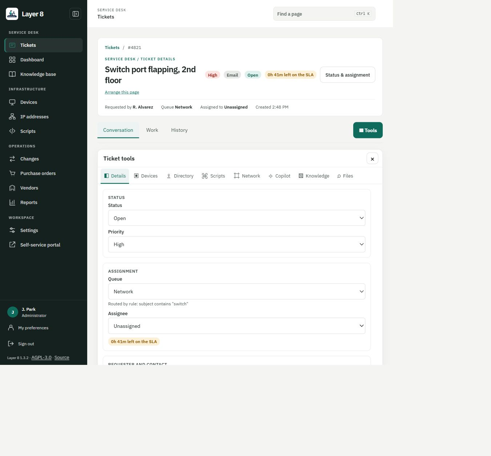
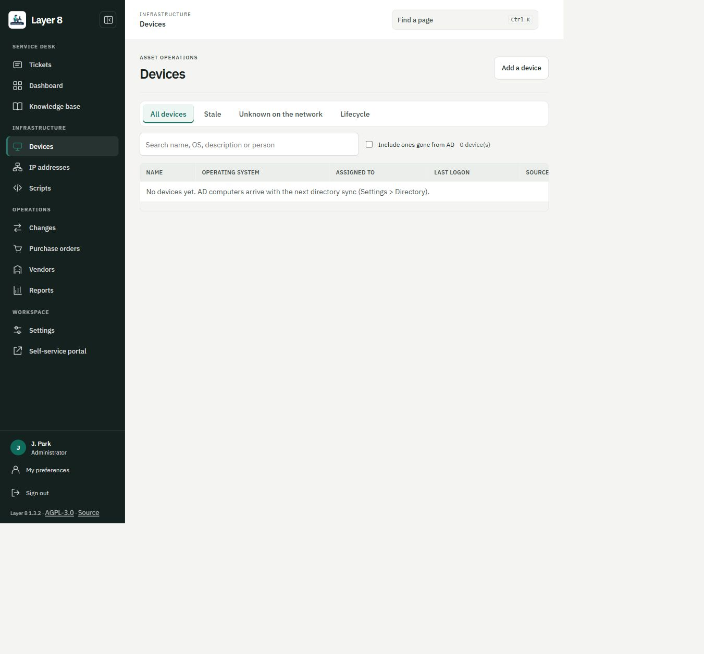
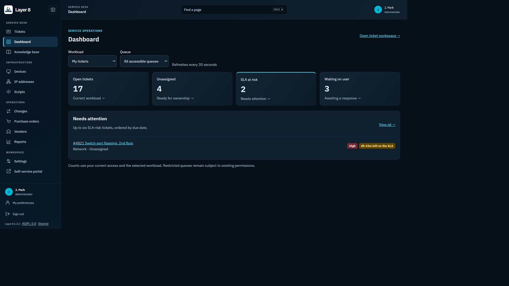
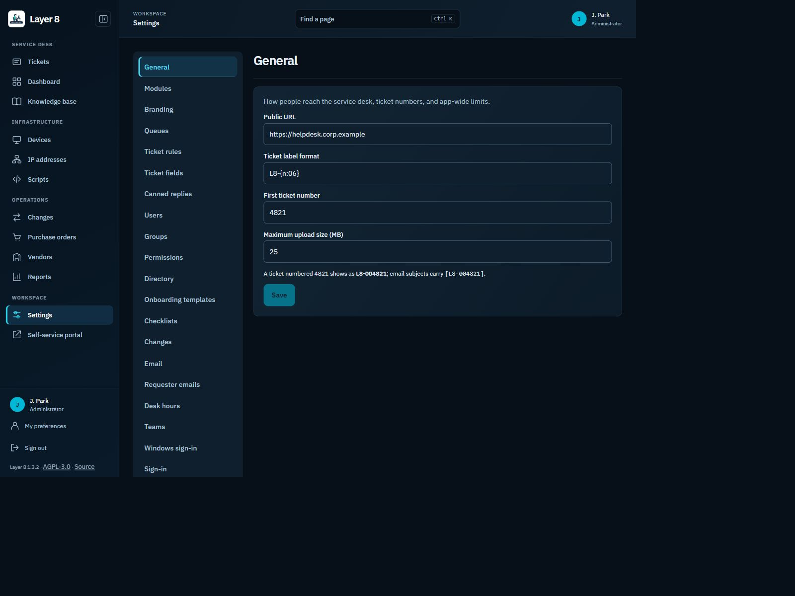

# Technician console layout review

This refresh changes the shared console layout across the application. It starts from v1.3.2 and keeps the existing API, permissions, personal/global module visibility, themes, routes and page tools.

The sidebar groups Tickets, Dashboard and Knowledge base under Service desk; Devices, IP addresses and Scripts under Infrastructure; Changes, Purchase orders, Vendors and Reports under Operations; Settings and the Self-service portal under Workspace. Hidden/disabled links are filtered before groups are rendered. Empty groups disappear. Tickets and account controls remain available.

The sidebar can collapse to an icon rail. It starts compact at a viewport width of 1050 CSS pixels or less and follows changes across that breakpoint. The toggle is temporary presentation state, not a stored account preference. It does not remount the workspace or clear a reply draft. Accessible link names, keyboard focus and tooltips remain available. Source and licence links stay visible in either size.

The header identifies the current module, retains the existing Ctrl+K page finder and unaccepted-ticket alert, and shows account information when space allows. Module headings, toolbars, cards and tables share spacing and border treatment. Queue scrolling and the Option B ticket tool drawer keep their existing behavior.

Settings categories/search are being reviewed separately in PR #78. This change does not alter Settings tabs or configuration behavior. Public portal, sign-in and remote wallboards retain their separate layouts. No new palette is installed and no tenant theme is changed.

## Review images

These are real React pages with synthetic fixture data and mocked API responses; they do not demonstrate a live integration or backend.

## Validation

Regression coverage checks visibility filtering, administrator recovery access, active ticket navigation, draft retention, responsive collapse and sign-out. Existing module, ticket drawer, permission and keyboard tests remain part of the full frontend suite. Browser checks cover the queue, ticket conversation/tools, dashboard, Devices, Reports and Settings with synthetic data in light and Midnight modes, including a 1000 x 750 CSS-pixel compact layout. Database-backed regression results are reported separately in the pull request.
