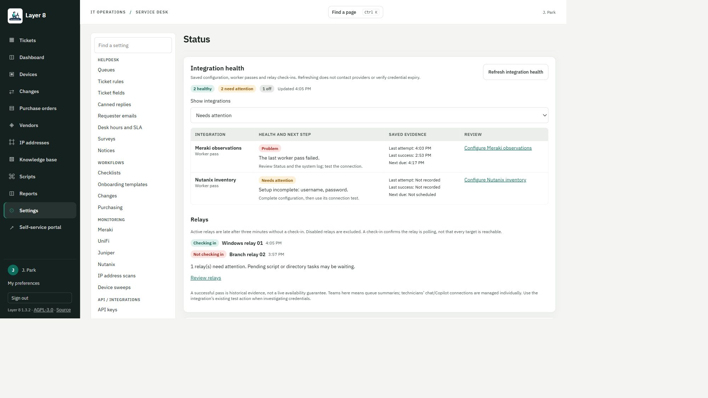
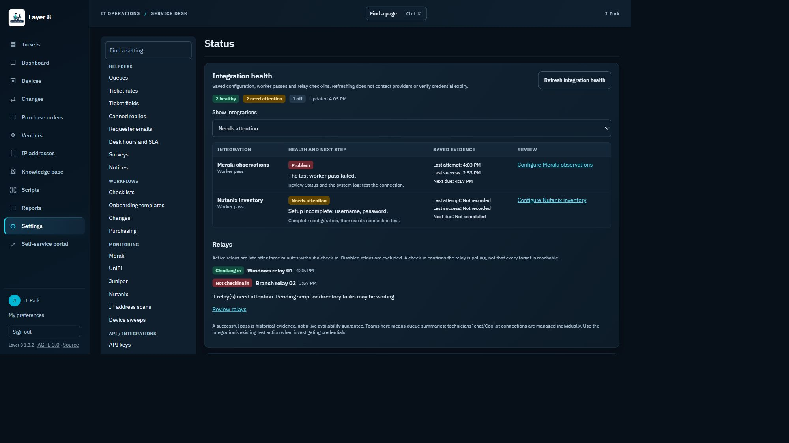

# Integration health

Settings > Status now starts with an **Integration health** panel, also available to administrators through `GET /api/system/integrations`. It is a read-only snapshot of local configuration and recorded work. Refresh reads local data; it does not call external providers, renew tokens, send notifications or run jobs.

The first slice covers Microsoft 365 mailbox processing, directory sync, Action1 patch visibility, Meraki observations, UniFi discovery, Nutanix inventory, Juniper switch reads and Teams queue summaries. Active relays are listed separately; disabled relays are excluded. The panel retains the existing Status services and job controls below it. It requires no optional integration to be enabled for ordinary local helpdesk use.

## Interpreting health

- **Off:** the integration is not enabled/in use. Off entries are hidden until All is selected.
- **Not checked:** configuration exists but no completed evidence is available.
- **Needs attention:** setup is incomplete, scheduled work is paused/overdue, or a pass/read is still running or waiting.
- **Problem:** the latest pass/read failed or the background worker is not checking in.
- **Healthy:** the saved evidence shows recent successful work. It is not a live availability or credential-validity guarantee.

Each row includes a recovery hint, configuration link, last attempt, last success and next scheduled worker pass where known. Needs attention includes problems and enabled integrations with no recorded check. Provider errors, secret values, signed webhook URLs and individual technician OAuth tokens are not included in this API response.

Directory health uses actual non-preview sync records, not the worker's routine checks for whether a sync is due. Juniper health uses completed relay read records, not merely the successful queueing of a script. Other entries report worker passes. A successful pass does not establish that every target is reachable or that credentials have not expired since it ran. Teams here covers queue summaries; each technician's chat/Copilot connection remains managed individually.

The worker is late after its existing three-minute heartbeat window. Active relays use the same three-minute check-in window as script previews. Scheduled jobs get a five-minute due-time grace and warn when completed evidence is older than twice their interval (at least five minutes). These are observations, not automatic restart or retry actions.

## Upgrade

Migration `892b614ce3af` adds nullable `worker_jobs.last_success_at`. Existing rows are backfilled only when their latest recorded pass succeeded. Earlier successes before an existing failure cannot be reconstructed and remain unknown. Future successful passes update this timestamp; failures preserve it. Downgrade removes the extra timestamp. There are no new settings, secrets or dependencies.

## Review

Real React pages with synthetic data and mocked API responses, not live provider results:

This PR is independent of the shared console-layout draft (#80), and retains the currently merged Settings categories/search. Follow-up helpdesk features are tracked in #81: permission-aware related incidents and reviewed ticket templates. Release numbering is deferred until review and validation of the feature set.
