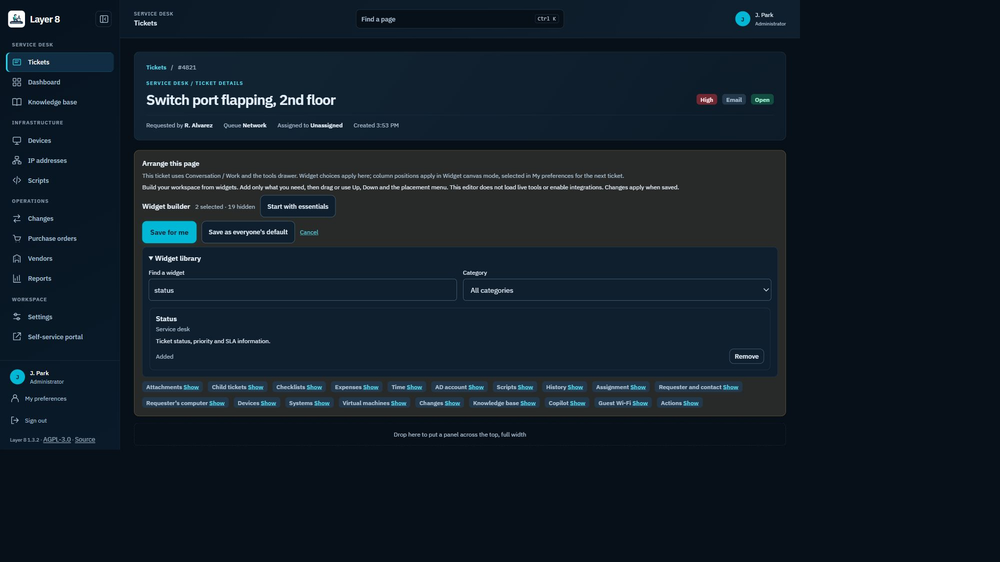
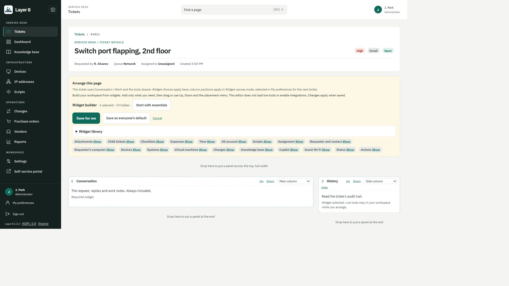

# Personal widget workspaces

**Arrange this page** on tickets and purchase orders is now a widget builder. Opening it shows descriptions and placement placeholders, rather than rendering every live tool. The ticket's previously visited drawer tools and reply stay mounted out of view while choosing widgets; unused tools are not loaded just to appear in the library.

## Build a focused pane

1. Open **Arrange this page**. Search the widget library or filter by category.
2. **Add** or **Remove** widgets, or choose **Start with essentials** to keep only the required Conversation/order widget as a starting point. This is a draft until saved.
3. Move selected widgets with drag and drop, Up/Down, or the placement menu: main column, side column, full-width top or bottom. The order form's existing field arrangement controls remain available.
4. **Save for me** to store the layout on your account. **Cancel** discards arrangement changes and returns focus to Arrange. Failed saves leave the draft open for retry; controls are locked while a save is pending.

Administrators retain **Save as everyone's default**; an individual's saved layout still takes precedence. **Use the default again** removes the personal override. Required widgets cannot be removed. Widgets that are currently unavailable cannot be added from the library; existing availability, permissions, module settings, credentials and action approvals still apply.

## Canvas and drawer

In **My preferences > Ticket workspace > Layout**, choose **Widget canvas (arranged panels)** for a page that uses the saved columns and full-width rows. The stored mode value is still `classic`, preserving existing API clients and preferences.

**Conversation with tools drawer** remains available. In that mode the same widget choices control which sections/tools appear, while the existing tab/drawer grouping determines placement. Mode changes take effect on the next ticket, preserving the current draft. The builder explains this distinction instead of switching modes underneath an open ticket. A conversation-only selection has no empty Tools button or shortcut to hidden detail widgets.

This slice covers the existing ticket and PO widgets; arbitrary embeds, user-authored code and dashboard widgets are not added. Personalizing the layout does not turn on a module or integration, grant a permission, run an action, or automatically save an open form.

## Saved layout compatibility

The existing `/api/layouts/{page}` APIs, JSON layouts in `users.layouts`, administrator defaults and installer `layouts` import/export remain in use. Saving through the builder adds `widget_mode: true`. In these explicit layouts, future optional widgets absent from the saved layout are normalized into `hidden`, ready to add from the library. Required widgets stay on the canvas. Layouts without the marker retain their existing normalization and existing assignments. There is no database migration.

Entering and cancelling the editor preserves mounted forms. As with the existing arranged layout, saving a move between columns or removing a widget can remount/remove that widget: save unfinished changes in such forms before changing their placement. Ticket reply/file draft state is separately retained. Field visibility changes keep their underlying order-form values.

## Review

Browser review uses real React components with synthetic ticket data and mocked API responses, not live integrations.

Regression coverage includes metadata-only editing, no unused-tool requests, reply draft and focus preservation, widget selection/search, required/unavailable widgets, keyboard placement, failed/pending saves, administrator defaults, purchase-order field layouts and API/import compatibility.
