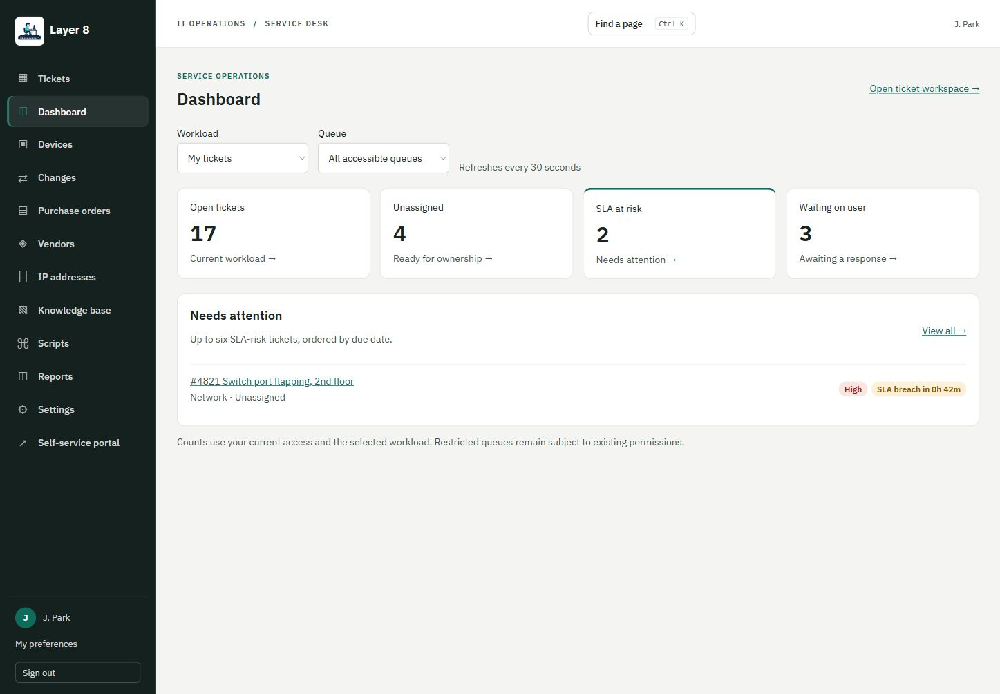
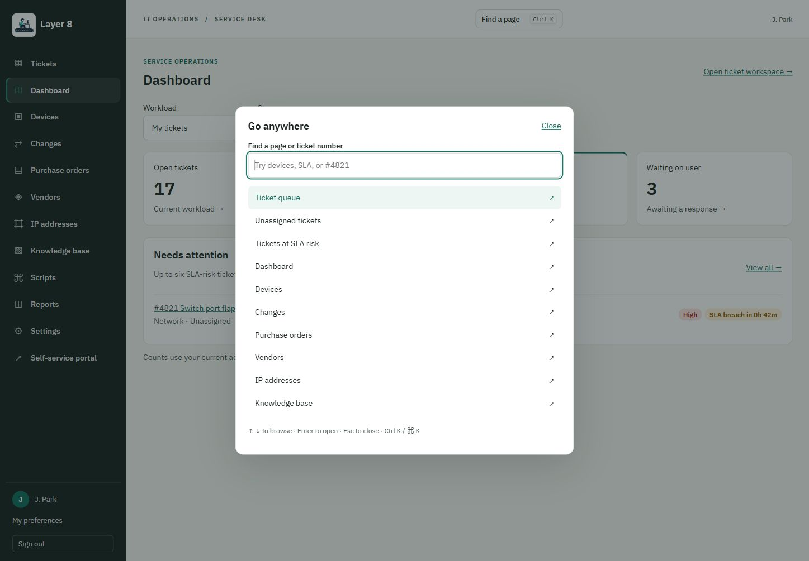
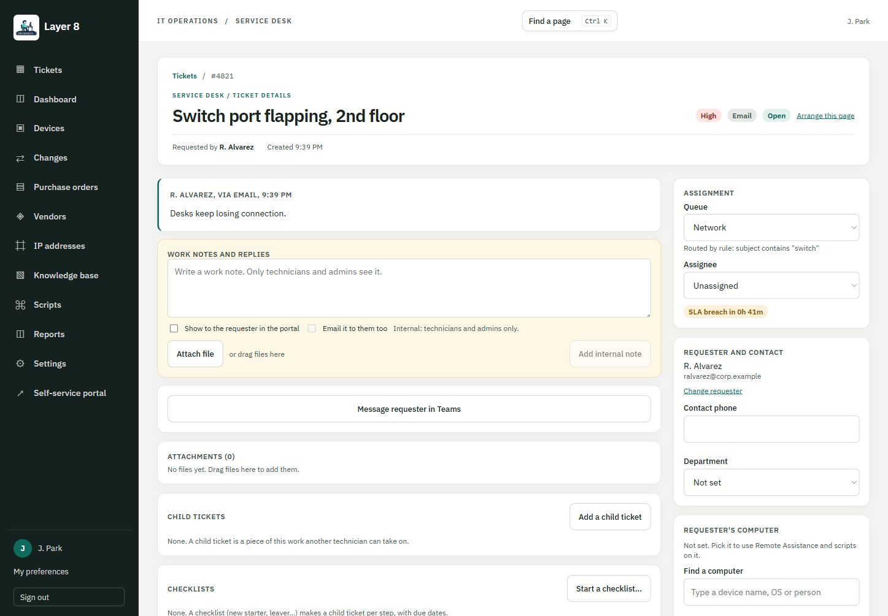
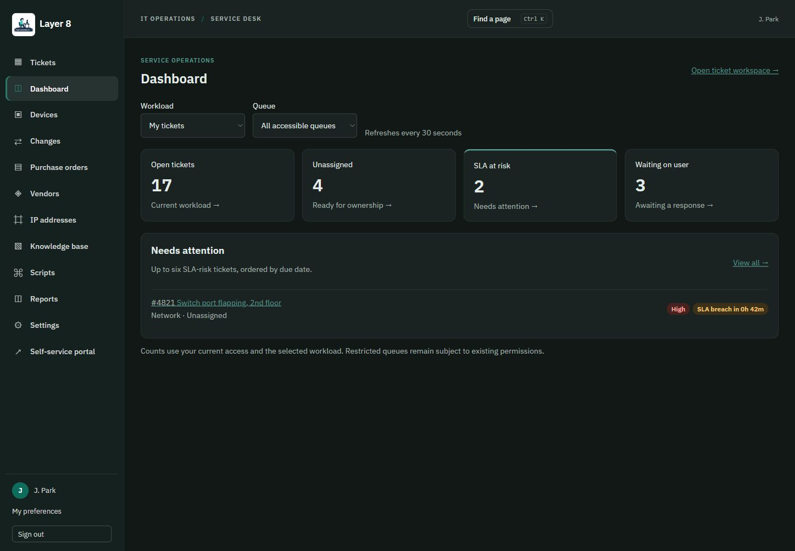
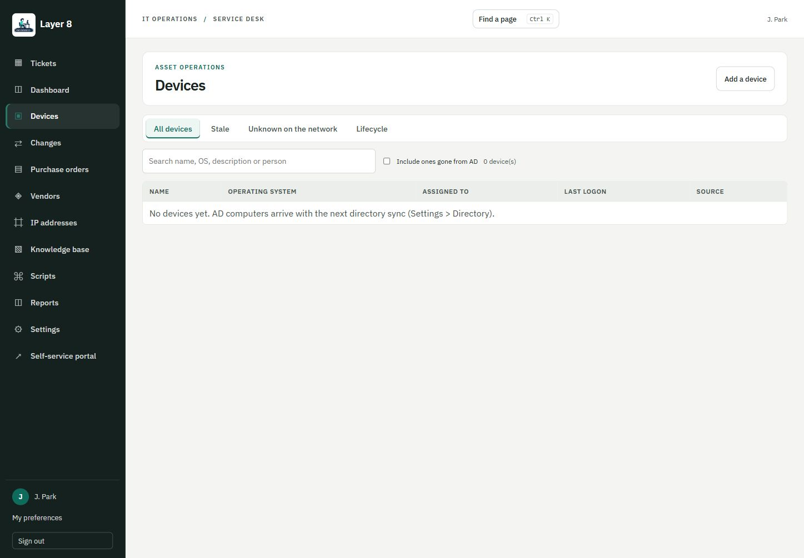
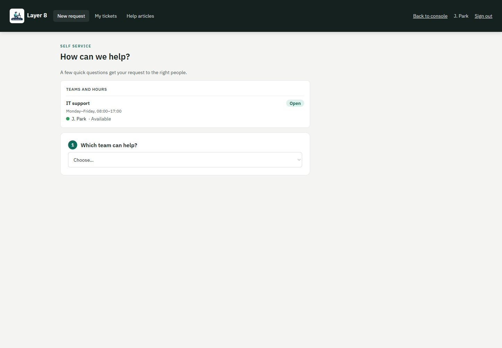
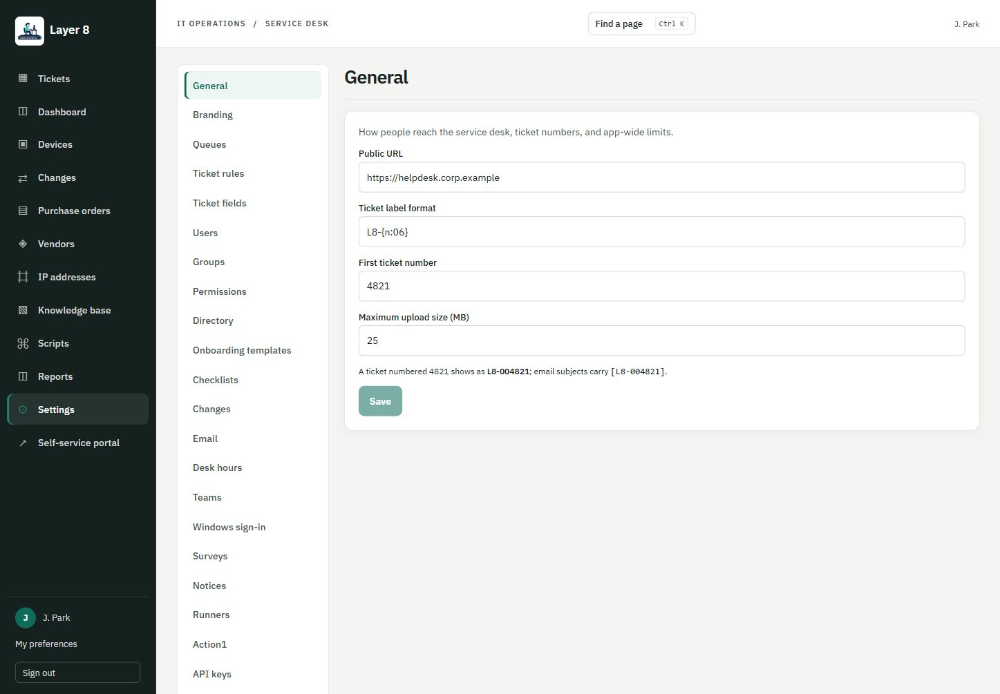
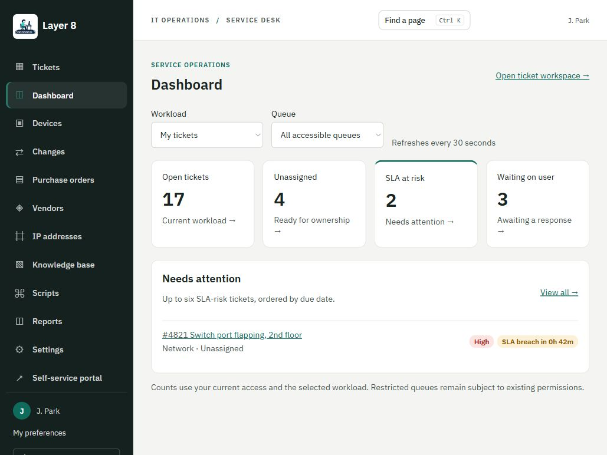

# Command Center GUI

Fresh browser captures from 22 October 2026, using actual React components with synthetic `corp.example` accounts and mocked API responses. Counts and settings are illustrative; the Devices image intentionally shows an empty inventory. No live Microsoft, Action1 or email requests were made.

The pictured modules match merged main `270fb29d300181b5d9bdb57dff5b1fa62c95418c`. Captures were taken from `544b48530e391af9bd6f2ab2562900ec2cd8f0a4`, based on that main; draft PR #32 changes the Copilot panel below the pictured ticket viewport, not the visible views here. The separate draft Copilot screenshot is deliberately excluded from this gallery.

Desktop captures are approximately 1447 × 1005 CSS pixels; the tablet dashboard is approximately 1029 × 772. This is a representative GUI gallery, not a screenshot of every module or proof of live integration/installation testing.

## Operations dashboard

## Ctrl+K command palette

## Ticket workspace

## Dashboard in dark mode

## Devices: empty inventory

## Self-service portal with hours and presence

## Settings navigation and representative General fields

## Dashboard on a tablet-sized viewport

